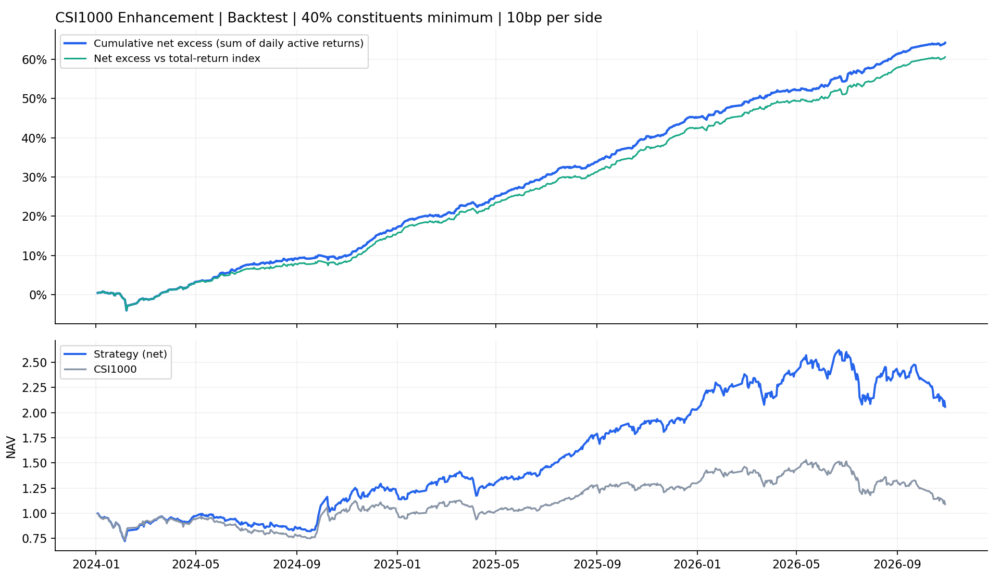

# 中证1000指数增强 · 40%成分股版本

**回测绩效｜2024-01-03 至 2026-10-29｜681 个交易日。**

日频调仓，全市场选股，中证1000成分股权重不低于40%，单票不超过2%。沿用既定选股信号及风险约束；买入、卖出各计 **0.1%（单边千一，双边千二）**，优化决策与净收益均使用这一成本。

| 区间 | 年化净超额 | 超额夏普（IR） | 跟踪误差 | 相对净值最大回撤 | 日均单边换手 |
|---|---:|---:|---:|---:|---:|
| 全部 | 23.77% | 6.30 | 3.77% | -4.71% | 5.78% |
| 2024 | 17.79% | 4.34 | 4.10% | -4.71% | 5.63% |
| 2025 | 29.19% | 9.14 | 3.20% | -1.28% | 6.20% |
| 2026 | 24.40% | 6.14 | 3.97% | -1.36% | 5.46% |

## 每日持仓与调仓

- [最新持仓](latest_holdings.csv)（持仓日 2026-10-29，信号日 2026-10-28）
- [逐日持仓目录](holdings/) · [按日期索引](holdings_index.csv)
- [最新调仓明细](latest_trades.csv)（历史调仓见逐日持仓文件） · [每日绩效](daily.csv) · [绩效汇总](summary.json)

持仓文件包括股票代码、收盘调仓后权重、上一日权重、交易前漂移权重、买入比例、卖出比例及成分股标记。权重用小数表示，0.01代表1%；当日全部卖出的股票保留为0权重。每天在原09:30绩效任务中更新，按已齐备的数据追加交易日。

## 回测口径

上一交易日信号与风险数据用于次日收盘调仓，新仓从调仓后开始计收益。按收盘价模拟成交，停牌及收盘涨跌停限制买卖。基准为中证1000价格指数，图中同时列示相对全收益指数的超额。

超额累加为每日扣费收益减基准收益后求和；年化净超额为该日均差额乘252；超额夏普（IR）为日均差额除以其标准差再乘√252。相对回撤按策略净值/基准净值计算。日均单边换手=(买入比例+卖出比例)/2；费用按买卖合计分别扣收，不重复计费。
